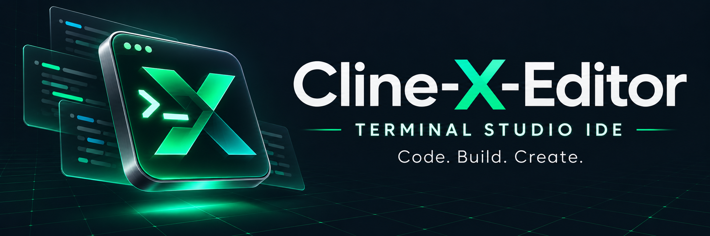

# ZH Code Studio

<div align="center">
  
  
  
  
  ```bash
to All my 4 Bitch Girl🖕🏻❌🤦‍♀️.
      FuckYou
"To live a little, you've got to love a whole lot. Love turns the ordinary into the extraordinary."
Untuk hidup sedikit, kamu harus banyak mencintai. Cinta mengubah yang biasa menjadi luar biasa.

"The love and relationship are all about understanding each other and overlooking the different matters, as well as mistakes."
Cinta dan hubungan adalah tentang saling memahami dan mengabaikan masalah perbedaan, serta kesalahan.
"The power of love is the energy that supplies all of your needs."
Kekuatan cinta adalah energi yang memasok semua kebutuhanmu.

"Love means patience, kindness, and being happy when you witness the happiness of others." 
Cinta berarti kesabaran, kebaikan, dan kebahagiaan ketika kamu menyaksikan kebahagiaan orang lain.
```
## Badges


## Linux

<p align="center">
  
    
</p>


## Overview

Terminal Studio IDE ialah platform pembangunan moden yang menggabungkan:

- Monaco Editor
- xterm.js Terminal
- Workspace Management
- File Explorer
- Git Integration
- AI Assistant
- Plugin Marketplace
- Authentication
- WebContainer Support

## Features

Lihat [matriks ciri](FEATURE-MATRIX.md) untuk skop yang tersedia dan kerja yang masih berbaki.

## Technology Stack

### Frontend

| Technology | Purpose |
| --- | --- |
| Vue 3 | UI Framework |
| TypeScript | Type Safety |
| Pinia | State Management |
| Vite | Build Tool |
| Monaco Editor | Code Editor |
| xterm.js | Terminal |

Editor kod dalam browser berinspirasikan VS Code: Vue 3 + Monaco + terminal sebenar dalam container.

## Prasyarat
- Node.js 20+, pnpm 9+, Python 3, make dan pengkompil C++ untuk node-pty
- PostgreSQL 16 (atau Docker)
- Docker Engine (untuk workspace runner)
- Akaun Resend (atau SMTP) untuk e-mel

## Pasang & Jalankan
```bash
cp .env.example .env          # isi nilai sebenar sebelum meneruskan
pnpm install
docker compose up -d postgres
docker build -f packages/backend/Dockerfile.workspace -t zhcode/workspace:latest .
set -a
. ./.env
set +a
pnpm db:migrate
pnpm dev                      # frontend :5173, backend :4000
```

Tetapkan `SESSION_SECRET` sekurang-kurangnya 32 aksara dan `WORKSPACE_STORAGE_ROOT` kepada direktori mutlak yang boleh ditulis oleh backend dan boleh dilekapkan oleh Docker Engine. Kontena workspace menggunakan UID 1000. Untuk akses melalui alamat selain `http://localhost:5173`, gunakan origin sebenar dalam `FRONTEND_ORIGIN`.

Kontena sedia ada masih menggunakan imej asal selepas imej baharu dibina. Cipta workspace baharu untuk mencuba profil shell baharu.

## Cipta akaun pertama
1. Buka `http://localhost:5173/register`.
2. Daftar → semak e-mel → klik pautan pengesahan.
3. Sign In → Dashboard → New Workspace (Vue + Vite).
4. Buka workspace → edit fail → Save → refresh browser.

## Ujian aliran kritikal
| Aliran | Perlu |
|---|---|
| Register → verify → Sign In | `RESEND_API_KEY` atau SMTP |
| Terminal `npm install && npm run dev` | Docker + image workspace |
| Git push | GitHub App / token repo ujian |
| Debug Node/Python | `launch.json` + debugger adapter |
| Preview | DNS wildcard `*.preview.domain` |

## Terminal dan alat pembangunan

Terminal Bash menjalankan Node.js, npm, npx, Git dan Python daripada imej Debian. Butang `+` membuka sesi tambahan dalam panel yang sama. Butang pemisah memaparkan dua sesi bersama Explorer dan editor. Gunakan **Ctrl + Shift + F** untuk carian projek, **Ctrl + B** untuk sidebar dan **Ctrl + backtick** untuk panel terminal.

```bash
node --version
npm --version
npx --version
python --version
git --version

python -m venv .venv
. .venv/bin/activate
python -m pip install requests
```

Node.js telah dipasang dalam imej. `npm install` memasang dependency projek. Gunakan `git commit -m "Mesej"` untuk commit dan tetapkan `origin` secara berasingan sebagai nama remote.

Untuk Firecrawl, jalankan arahan berikut dalam terminal workspace.

```bash
codex --version
codex mcp add firecrawl --url https://mcp.firecrawl.dev/v2/mcp-oauth
codex mcp login firecrawl --no-browser
```

1. Buka pautan autorisasi yang dipaparkan dalam pelayar. Log masuk ke Firecrawl dan pilih pasukan.
2. Jika pelayar memaparkan ralat sambungan selepas menghala ke `127.0.0.1`, salin URL penuh daripada bar alamat dan tampal terus ke prompt Codex dalam terminal workspace. URL itu mengandungi kod log masuk sementara.
3. Selepas Codex mengesahkan log masuk, jalankan `codex mcp list` untuk menyemak entri Firecrawl.

Bina semula imej workspace dan cipta workspace baharu untuk menggunakan Codex CLI dan `python -m venv`. Akses Git remote dan registry pakej memerlukan rangkaian dan kelayakan yang sesuai.

Runner ini menggunakan Debian bersama `apt` dengan akses pengguna biasa. Kemas kini atau tambah pakej sistem melalui [Dockerfile.workspace](packages/backend/Dockerfile.workspace). `sudo apt upgrade`, `pkg` dan runtime OS/VM lain belum tersedia.
