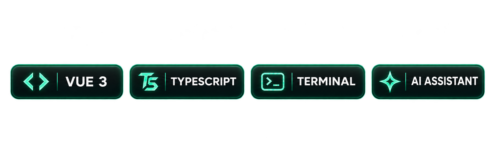
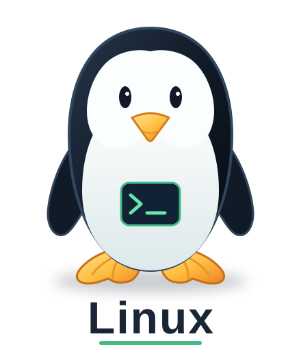

# ZH Code Studio

<div align="center">
  
  
  
  
  ```bash
pilihan.
"To live a little, you've got to love a whole lot. Love turns the ordinary into the extraordinary."
Untuk hidup sedikit, kamu harus banyak mencintai. Cinta mengubah yang biasa menjadi luar biasa.
"The love and relationship are all about understanding each other and overlooking the different matters, as well as mistakes."
Cinta dan hubungan adalah tentang saling memahami dan mengabaikan masalah perbedaan, serta kesalahan.
"The power of love is the energy that supplies all of your needs." 
Kekuatan cinta adalah energi yang memasok semua kebutuhanmu.
"Love means patience, kindness, and being happy when you witness the happiness of others." 
Cinta berarti kesabaran, kebaikan, dan kebahagiaan ketika kamu menyaksikan kebahagiaan orang lain.
```
## Badges


## Linux

<p align="center">
  
    
</p>


## Overview

Terminal Studio IDE ialah platform pembangunan moden yang menggabungkan:

- Monaco Editor
- xterm.js Terminal
- Workspace Management
- File Explorer
- Git Integration
- AI Assistant
- Plugin Marketplace
- Authentication
- WebContainer Support

## Features

Status berikut dikekalkan daripada dokumentasi asal dan belum disahkan terhadap kod projek.

| Module | Status |
| --- | --- |
| Monaco Editor | Sedia |
| xterm.js Terminal | Sedia |
| File Explorer | Sedia |
| Workspace | Sedia |
| Authentication | Sedia |
| WebSocket | Sedia |
| AI Assistant | Sedia |
| Plugin Marketplace | Dalam pembangunan |
| Collaboration | Dalam pembangunan |
| Cloud Sync | Dalam pembangunan |

## Technology Stack

### Frontend

| Technology | Purpose |
| --- | --- |
| Vue 3 | UI Framework |
| TypeScript | Type Safety |
| Pinia | State Management |
| Vite | Build Tool |
| Monaco Editor | Code Editor |
| xterm.js | Terminal |

Editor kod dalam browser berinspirasikan VS Code: Vue 3 + Monaco + terminal sebenar dalam container.

## Prasyarat
- Node.js 20+, pnpm 9+
- PostgreSQL 16 (atau Docker)
- Docker Engine (untuk workspace runner)
- Akaun Resend (atau SMTP) untuk e-mel

## Pasang & Jalankan
```bash
cp .env.example .env          # isi nilai sebenar
pnpm install
docker compose up -d postgres
pnpm db:generate && pnpm db:migrate
pnpm dev                      # frontend :5173, backend :4000
```

## Cipta akaun pertama
1. Buka `http://localhost:5173/register`.
2. Daftar → semak e-mel → klik pautan pengesahan.
3. Sign In → Dashboard → New Workspace (Vue + Vite).
4. Buka workspace → edit fail → Save → refresh browser.

## Ujian aliran kritikal
| Aliran | Perlu |
|---|---|
| Register → verify → Sign In | `RESEND_API_KEY` atau SMTP |
| Terminal `npm install && npm run dev` | Docker + image workspace |
| Git push | GitHub App / token repo ujian |
| Debug Node/Python | `launch.json` + debugger adapter |
| Preview | DNS wildcard `*.preview.domain` |
